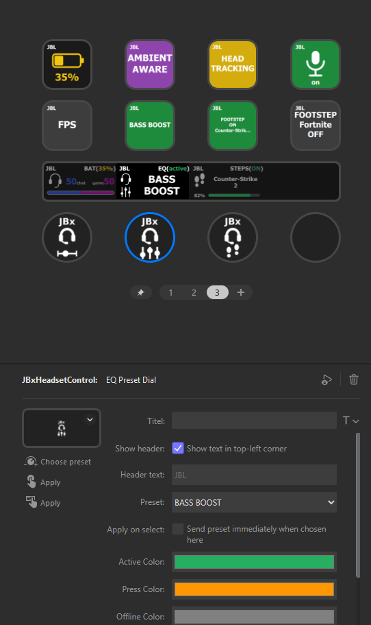

# MyJBxHeadsetControl

A Stream Deck plugin for the **JBL Quantum 950 Wireless** headset.



Control your JBL Quantum 950 Wireless headset directly from an Elgato Stream Deck -
JBL QuantumENGINE doesn't need to be running. The plugin talks to the headset's USB dongle
over a reverse-engineered HID protocol and shows live status on your keys and dials.
EQ presets are read from your QuantumENGINE installation (see [EQ presets](#eq-presets)).

> This project is not affiliated with, endorsed by, or supported by JBL / HARMAN.
> Use at your own risk. The author is not responsible for any hardware damage or software conflicts.

### Why is this not on the Elgato Marketplace?
Due to recent changes in the Elgato Maker Agreement, developers are now required to accept comprehensive personal liability and indemnification clauses under Californian law. As an independent developer offering free, open-source hobby projects, I cannot accept these legal and financial risks.

Therefore, this plugin—and all future updates to my existing plugins—will exclusively be published here on GitHub. You can always find the latest, safe-to-use `.streamDeckPlugin` files directly on the Releases page.

## Features

| Action | Type | What it does |
|---|---|---|
| **Mute** | Key | Toggles mic mute. Shows a microphone icon: white when live, red and crossed out when muted. Offline / No Dongle states show a configurable header and colors. |
| **ANC / Ambient** | Key | Cycles Off → Noise Cancelling → Ambient Aware, colors configurable |
| **Spatial Sound** | Key | Cycles Off → Fixed → Head Tracking, colors configurable |
| **Battery** | Key | Live battery level drawn as a battery that fills according to the charge, with configurable thresholds and colors |
| **Game-Chat Balance** | Dial | Custom display: JBL header, live battery readout, headset icon and a two-color balance bar. Rotate to adjust, press to reset to 50/50. Last value is persisted. |
| **EQ Preset** | Key | Applies an EQ preset from QuantumENGINE - system presets and your own. Shows the preset name, highlighted when active. Optional: apply right when chosen in the Property Inspector. |
| **EQ Preset Dial** | Dial | Rotate to browse all EQ presets, press or tap to apply. |
| **Footstep Booster** | Key | Toggles the QuantumENGINE Footstep Booster on/off and shows the selected game profile. Optionally fixed to one game: a press switches to that game and turns it on, a second press turns it off. Needs QuantumENGINE running, see [Footstep Booster](#footstep-booster). |
| **Footstep Booster Dial** | Dial | Rotate to choose the game, rotate while pressed to change the strength, press or tap for on/off. Shows game, state and strength. Needs QuantumENGINE running. |

Every key can show a configurable header text (default `JBL`) in the top-left corner -
toggle it on/off and change the text per action in the Property Inspector.

All actions react instantly to changes made elsewhere (headset buttons, the wheel on
the earcup, or QuantumENGINE) and show **OFFLINE** when the headset is powered off and
**NO DONGLE** when the USB dongle is unplugged, including automatic reconnect. On start
the plugin asks the dongle for the link state and all current values, so the keys are right
even if the headset was switched on before the PC. Offline
and No-Dongle colors are configurable per action.

## Requirements

- JBL Quantum 950 Wireless with its 2.4 GHz USB dongle
- Elgato Stream Deck software 7.1+ (SDK v3, Node.js 20 plugin runtime)
- Windows 10/11 (developed and tested on Windows; macOS untested)
- For the EQ actions only: JBL QuantumENGINE installed (Windows), see [EQ presets](#eq-presets)
- For the Footstep Booster only: JBL QuantumENGINE installed and its service running, see [Footstep Booster](#footstep-booster)

## Installation

### From a release (recommended)

1. Download the latest `com.holgermilz.myjbxheadsetcontrol.streamDeckPlugin`
   from the [Releases page](https://github.com/666mille/MyJBxHeadsetControl/releases).
2. Double-click the file - the Stream Deck app installs the plugin automatically.

### From source

```bash
git clone https://github.com/666mille/MyJBxHeadsetControl.git
cd MyJBxHeadsetControl
npm install
npm run build
streamdeck link com.holgermilz.myjbxheadsetcontrol.sdPlugin
```

`streamdeck` is the [Elgato CLI](https://docs.elgato.com/sdk/plugins/cli)
(`npm i -g @elgato/cli`). For development use `npm run watch`, which rebuilds and
restarts the plugin on every change. Note: `watch` only reloads the plugin code -
after changing the manifest, layouts or Property Inspector HTML, quit the Stream
Deck app completely and restart it.

#### Packaging

`node-hid` and `koffi` are native modules and are not bundled into `plugin.js`, so they
have to ship inside the plugin folder. Install them there before packing:

```bash
cd com.holgermilz.myjbxheadsetcontrol.sdPlugin
npm install --omit=dev
cd ..
npm run pack
```

The plugin folder contains its own small `package.json` for this (`"type": "module"`,
dependencies `node-hid` and `koffi`).

#### Testing the EQ without a Stream Deck

```bash
npx tsx test-eq.ts list            # presets from q950.dat + DLL self-test
npx tsx test-eq.ts send "FLAT"     # send a preset to the headset
```

Quit the Stream Deck app first, so the plugin doesn't hold the dongle at the same time.

#### Testing the Footstep Booster without a Stream Deck

```bash
npx tsx test-footstep.ts           # read state (on/off, game, strength)
npx tsx test-footstep.ts on        # switch on (or off)
npx tsx test-footstep.ts eq "FPS"  # switch the EQ preset through the service
```

## Usage notes

- **Close JBL QuantumENGINE** while using the plugin if you notice conflicts - both
  talk to the same HID interface.
- The dial shows the current game/chat split; the colored numbers and the bar use the
  configurable **chat** and **game** colors.

## EQ presets

The EQ actions use the presets you see in JBL QuantumENGINE, including your own:

- Presets are read from `C:\ProgramData\QuantumENGINE\q950\q950.dat`. Create or edit
  presets in QuantumENGINE, they show up in the plugin automatically.
- Without the QuantumENGINE service, the headset expects precomputed filter coefficients. The plugin computes them with
  `libAirohaEQSerializeImp.dll` from your local QuantumENGINE installation (found
  automatically, or set the path in the Property Inspector). The DLL is **not** part of
  this plugin.
- On start the plugin runs a self-test: it computes FLAT and compares it byte for byte
  with the data QuantumENGINE sends. If it doesn't match, the EQ actions stay locked and
  nothing is sent. This matters because a wrong coefficient block can mute the headset
  until a valid preset is sent.
- **With QuantumENGINE running**, the plugin simply asks the QuantumENGINE service to
  switch the preset, exactly like clicking it in QuantumENGINE. The QuantumENGINE window
  follows right away, and presets chosen in QuantumENGINE show up on the keys and the dial
  immediately (the service sends a notification).
- **Without QuantumENGINE running**, the plugin computes the coefficients itself (below)
  and sends them to the headset. QuantumENGINE then keeps showing its own last selection.

Without QuantumENGINE installed, all other actions work as usual; the EQ actions show
**Locked** in the Property Inspector.

## Working together with QuantumENGINE

When QuantumENGINE is installed and its service is running, the plugin sends mute, the
game/chat balance and EQ presets **through the QuantumENGINE service** instead of straight to
the dongle, so the QuantumENGINE window follows them right away and its stored settings stay
in line with the headset. After a mute change the plugin asks the dongle whether it arrived
and sends it over HID itself if not.

Every mute, ANC, Ambient Aware and spatial sound key press reads the real state from the
dongle first, then confirms that the headset took the change and retries once; otherwise
the key shows an alert.

ANC, Ambient Aware and spatial sound are sent over HID in any case: the headset reports them
back like a button press on the earcup, which QuantumENGINE picks up and shows. Sent through
the service, the headset would switch but the QuantumENGINE window would not be told.

Without QuantumENGINE everything goes over HID as before.

Pressing the knob on the base station (the Q950 dongle) makes the plugin refresh all values
right away, so the keys follow whatever the knob is assigned to in QuantumENGINE.

## Footstep Booster

The Footstep Booster is different from every other feature here: it does not run on the
headset. JBL QuantumENGINE boosts footsteps in the game audio on the PC before it is sent
to the dongle, so there is nothing to switch over USB.

- The plugin talks to the QuantumENGINE service (`QuantumServer.exe`) the same way the
  QuantumENGINE app does, through `IPC.dll` from your local installation. The DLL is
  **not** part of this plugin. QuantumENGINE has to be installed and its service running;
  the QuantumENGINE window itself can stay closed.
- Without the service the key shows **NO QUANTUM ENGINE**. Pressing it retries.
- The plugin itself always shows the real state, because it reads it from the service
  (and gets notified when it changes there).
- The game and the strength can be set from the key (fixed game) and the dial.

## What the QuantumENGINE window shows

Tested with QuantumENGINE **v2.9.4**. Everything set from the Stream Deck is applied, but not
everything shows up in the QuantumENGINE window right away:

| Setting | Shown in the QuantumENGINE window |
|---|---|
| Mute, game/chat balance, EQ preset, ANC / Ambient Aware, Footstep game | immediately |
| Footstep Booster on/off, Footstep strength, spatial sound | only after QuantumENGINE is restarted |

This is how the QuantumENGINE service is built, not a plugin problem: when a client sets the
footstep game, the service tells all other clients (including its own window); for footstep
on/off, strength and the spatial sound mode it stores and applies the value but does not tell
anyone. The only on/off path that does notify is the knob on the base station, which is fed
by the hardware and cannot be triggered from software. A switch of the QuantumENGINE profile
would refresh the window too, but it reloads the saved profile and would undo the change.

The values are stored in the QuantumENGINE profile, so after a restart of QuantumENGINE (or
the PC) the window is correct again, and the headset never gets out of sync with the service.
A future QuantumENGINE version may add the missing notifications; then the window will follow
without any change to the plugin.

## Troubleshooting

**The headset shows OFFLINE even though it is on**

The dongle only reports the headset once it has received a real status update. If you
turn the headset on *after* the PC (or after Stream Deck started), the plugin may not
have seen a status packet yet. To force one:

- **turn the volume wheel a notch**, or
- **toggle ANC / mute once**, or
- **power the headset off and on again**.

Any of these makes the headset send a status packet, and the display switches to online
immediately. Tip: switching the headset on while the PC is already running usually
avoids this entirely.

**Nothing updates / values are stuck**

Make sure JBL QuantumENGINE is closed, then quit and restart the Stream Deck app.

**EQ actions show "Locked" or the preset list stays empty**

The status line in the Property Inspector shows the reason. Usually the DLL wasn't
found: enter the path to `libAirohaEQSerializeImp.dll` (typically
`C:\Program Files\JBL\QuantumENGINE\PEQ\`) in the Property Inspector.
An empty list means `q950.dat` couldn't be read - start QuantumENGINE once so it creates it.

**Logs**

`%appdata%\Elgato\StreamDeck\Plugins\com.holgermilz.myjbxheadsetcontrol.sdPlugin\logs`

## How it works

The Quantum 950 dongle exposes several HID collections on USB interface 5. The plugin
opens the vendor collection with a single shared handle:

- **Events in:** the dongle pushes status packets (`86 00 dd ...`) for battery, mute,
  ANC, ambient aware, spatial mode, game-chat balance and headset power. A watchdog
  additionally polls the device list to detect dongle unplug/replug.
- **Commands out:** settings are written as 64-byte feature reports
  (`88 00 dd 02 00 01 00 05 00 <codeA> <codeB> 01 00 <value>`).

Connection state starts pessimistically as *offline* and only turns *online* on the
first genuine status packet from the headset (known status code or head-tracking data).
Plain dongle background traffic is deliberately ignored, so an unpowered headset is
correctly shown as OFFLINE. The state stays online until the explicit power-off event
arrives or the dongle is removed.

State is kept in memory with a pub/sub mechanism (mirrored to disk in a debounced,
bundled write) so every key and the dial update immediately when anything changes.

### How the EQ works

An EQ preset in QuantumENGINE is just 10 gain values (31 Hz to 16 kHz). The headset,
however, can't do anything with gain values on its own - its DSP needs ready-made
**filter coefficients** (one peaking filter per band, for several sample rates).
QuantumENGINE computes them on the PC and sends both to the headset. The plugin does
the same:

1. **Read the preset** - name, frequencies, gains and Q of all presets come from
   QuantumENGINE's `q950.dat`, including your own presets.
2. **Build the band info** (`0x0E02`) - band values plus the preset name. The plugin
   builds this block itself.
3. **Compute the coefficients** (`0x0E7F`, 858 bytes) - this is what actually changes
   the sound. The math lives in the function `serializePEQ` inside
   `libAirohaEQSerializeImp.dll`, which ships with QuantumENGINE. The plugin loads
   this DLL from your local installation via [koffi](https://koffi.dev) and calls it with
   the preset's values - exactly like QuantumENGINE does. The DLL is not included in
   this plugin and is only used for this step.
4. **Self-test** - before the first use, the plugin computes FLAT and compares the result
   byte for byte with the data captured from QuantumENGINE. Only if it matches are the
   EQ actions enabled. A wrong coefficient block can mute the headset until a valid
   preset is sent, so nothing is sent without a passing self-test.
5. **Send** - both blocks go out as multi-packet feature reports (54-byte chunks), in the
   same order and timing as QuantumENGINE: band info first, a short pause for the
   headset's acknowledgement, then the coefficients.

Why not compute the coefficients without the DLL? The exact fixed-point format and
ordering inside the 858-byte block could be partly reverse-engineered, but not byte-exact.
Using JBL's own function guarantees the headset gets the same data as from QuantumENGINE.

## Credits

Protocol reverse-engineered with a USB analyzer and a lot of patience.

Special thanks to **[@Shiro836](https://github.com/Shiro836)** for the EQ research: the
EQ feature IDs, the insight that the coefficients come from `serializePEQ` in
QuantumENGINE's DLL, and the verified preset data that made the EQ support possible.

Built with the [Elgato Stream Deck SDK](https://docs.elgato.com/sdk),
[node-hid](https://github.com/node-hid/node-hid) and [koffi](https://koffi.dev).

## License

[MIT](LICENSE) (c) 2026 Holger Milz