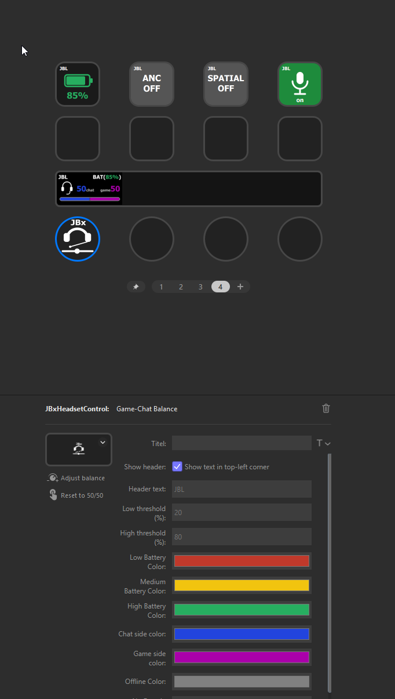

# MyJBxHeadsetControl

A Stream Deck plugin for the **JBL Quantum 950 Wireless** headset.



Control your JBL Quantum 950 Wireless headset directly from an Elgato Stream Deck -
no JBL QuantumENGINE required. The plugin talks to the headset's USB dongle over a
reverse-engineered HID protocol and shows live status on your keys and dials.

> This project is not affiliated with, endorsed by, or supported by JBL / HARMAN.
> Use at your own risk.

## Features

| Action | Type | What it does |
|---|---|---|
| **Mute** | Key | Toggles mic mute. Shows a microphone icon: white when live, red and crossed out when muted. Offline / No Dongle states show a configurable header and colors. |
| **ANC / Ambient** | Key | Cycles Off → Noise Cancelling → Ambient Aware, colors configurable |
| **Spatial Sound** | Key | Cycles Off → Fixed → Head Tracking, colors configurable |
| **Battery** | Key | Live battery level drawn as a battery that fills according to the charge, with configurable thresholds and colors |
| **Game-Chat Balance** | Dial | Custom display: JBL header, live battery readout, headset icon and a two-color balance bar. Rotate to adjust, press to reset to 50/50. Last value is persisted. |

Every key can show a configurable header text (default `JBL`) in the top-left corner -
toggle it on/off and change the text per action in the Property Inspector.

All actions react instantly to changes made elsewhere (headset buttons, the wheel on
the earcup, or QuantumENGINE) and show **OFFLINE** when the headset is powered off and
**NO DONGLE** when the USB dongle is unplugged, including automatic reconnect. Offline
and No-Dongle colors are configurable per action.

## Requirements

- JBL Quantum 950 Wireless with its 2.4 GHz USB dongle
- Elgato Stream Deck software 7.1+ (SDK v3, Node.js 20 plugin runtime)
- Windows 10/11 (developed and tested on Windows; macOS untested)

## Installation

### From a release (recommended)

1. Download the latest `com.holgermilz.myjbxheadsetcontrol.streamDeckPlugin`
   from the [Releases page](https://github.com/666mille/MyJBxHeadsetControl/releases).
2. Double-click the file - the Stream Deck app installs the plugin automatically.

### From source

```bash
git clone https://github.com/666mille/MyJBxHeadsetControl.git
cd MyJBxHeadsetControl
npm install
npm run build
streamdeck link com.holgermilz.myjbxheadsetcontrol.sdPlugin
```

`streamdeck` is the [Elgato CLI](https://docs.elgato.com/sdk/plugins/cli)
(`npm i -g @elgato/cli`). For development use `npm run watch`, which rebuilds and
restarts the plugin on every change. Note: `watch` only reloads the plugin code -
after changing the manifest, layouts or Property Inspector HTML, quit the Stream
Deck app completely and restart it.

## Usage notes

- **Close JBL QuantumENGINE** while using the plugin if you notice conflicts - both
  talk to the same HID interface.
- The dial shows the current game/chat split; the colored numbers and the bar use the
  configurable **chat** and **game** colors.

## Troubleshooting

**The headset shows OFFLINE even though it is on**

The dongle only reports the headset once it has received a real status update. If you
turn the headset on *after* the PC (or after Stream Deck started), the plugin may not
have seen a status packet yet. To force one:

- **turn the volume wheel a notch**, or
- **toggle ANC / mute once**, or
- **power the headset off and on again**.

Any of these makes the headset send a status packet, and the display switches to online
immediately. Tip: switching the headset on while the PC is already running usually
avoids this entirely.

**Nothing updates / values are stuck**

Make sure JBL QuantumENGINE is closed, then quit and restart the Stream Deck app.

**Logs**

`%appdata%\Elgato\StreamDeck\Plugins\com.holgermilz.myjbxheadsetcontrol.sdPlugin\logs`

## How it works

The Quantum 950 dongle exposes several HID collections on USB interface 5. The plugin
opens the vendor collection with a single shared handle:

- **Events in:** the dongle pushes status packets (`86 00 dd ...`) for battery, mute,
  ANC, ambient aware, spatial mode, game-chat balance and headset power. A watchdog
  additionally polls the device list to detect dongle unplug/replug.
- **Commands out:** settings are written as 64-byte feature reports
  (`88 00 dd 02 00 01 00 05 00 <codeA> <codeB> 01 00 <value>`).

Connection state starts pessimistically as *offline* and only turns *online* on the
first genuine status packet from the headset (known status code or head-tracking data).
Plain dongle background traffic is deliberately ignored, so an unpowered headset is
correctly shown as OFFLINE. The state stays online until the explicit power-off event
arrives or the dongle is removed.

State is kept in memory with a pub/sub mechanism (mirrored to disk in a debounced,
bundled write) so every key and the dial update immediately when anything changes.

## Credits

Protocol reverse-engineered with a USB analyzer and a lot of patience.
Built with the [Elgato Stream Deck SDK](https://docs.elgato.com/sdk) and
[node-hid](https://github.com/node-hid/node-hid).

## License

[MIT](LICENSE) (c) 2026 Holger Milz